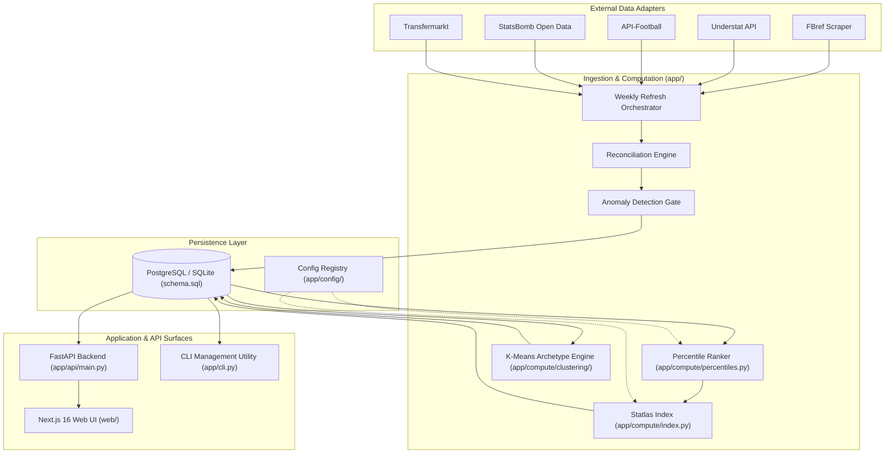

# Statlas

[](https://github.com/themanoj-025/Statlas/actions)
[](https://www.python.org/)
[](https://fastapi.tiangolo.com)
[](https://nextjs.org)
[](tests/)
[](LICENSE)

> A transparent, self-hostable football analytics and scouting platform that ingests raw per-90 metrics, computes percentile rankings and composite Statlas Index scores, discovers unsupervised ML player archetypes, and surfaces findings through an interactive Next.js application and FastAPI backend.

---

## Quick Facts

| Dimension | Details |
| --- | --- |
| **Core Architecture** | Decoupled Next.js 16 (App Router) + FastAPI 0.110 REST backend (`app/`) |
| **Data Ingestion** | Multi-source adapters (FBref, Understat, API-Football, StatsBomb, Transfermarkt) |
| **Methodology Standard** | Methodology-as-code (`metric_registry.json`, `tiers.json`, dated immutable snapshots) |
| **Composite Metric** | Proprietary **Statlas Index** (position-tailored weighted mean normalized across peers) |
| **Machine Learning** | Unsupervised k-means clustering for player archetype discovery with silhouette validation |
| **Scouting Features** | Workspaces, status lifecycle transitions, query builder, verified reports, watchlists |
| **Test Verification** | 894 collected pytest tests + Node unit tests + Playwright E2E suites |
| **License** | GNU Affero General Public License v3.0 ([LICENSE](LICENSE)) |

---

## Table of Contents

- [Overview](#overview)
- [Key Features](#key-features)
- [System Architecture](#system-architecture)
- [Methodology and Analytics](#methodology-and-analytics)
- [Repository Structure](#repository-structure)
- [Quick Start](#quick-start)
- [API Reference](#api-reference)
- [Configuration](#configuration)
- [Verification and Testing](#verification-and-testing)
- [Roadmap](#roadmap)
- [Contributing](#contributing)
- [License](#license)

---

## Overview

Modern football scouting and analytics suffer from opaque data sources, inconsistent metric definitions, and unverified statistical claims. **Statlas** establishes a rigorous, transparent alternative: **football analytics that shows its work**.

Every statistical figure in Statlas is anchored to a dated snapshot and a published, reproducible formula. The platform ingests match and season data from diverse providers, normalizes values into peer-grouped percentile rankings, trains machine learning models to cluster player archetypes, and renders interactive scouting reports, radar comparisons, shot maps, and passing networks.

Statlas operates out of the box using a fixture-demo dataset (`STATLAS_DATASET_MODE=fixture-demo`), enabling full local development and evaluation without requiring external paid API keys.

---

## Key Features

- **Transparent Methodology-as-Code**: Every metric definition, position weighting, and threshold is locked in versioned JSON configurations (`metric_registry.json`, `tiers.json`).
- **Percentile Radar & Trend Comparisons**: Generates multi-axis radar charts and historical snapshot trends comparing players against specific league tiers and positional cohorts.
- **ML Player Archetype Discovery**: Employs k-means clustering on per-90 performance attributes to automatically categorize players into behavioral profiles (e.g., *Box-to-Box Disruptor*, *Deep-Lying Progressor*).
- **Proportionally Accurate Pitch Maps**: Visualizes shot distributions, pass networks, and spatial completion densities using StatsBomb event coordinates mapped to a regulation 120×80 pitch.
- **Scouting Workspaces & Pipelines**: Facilitates recruitment workflows with user-owned shortlists, custom tags, status lifecycle management (Discovered, Scouting, Target, Signed), and audit logs.
- **Structured Query Builder**: Allows analysts to compose complex multi-condition filters across per-90 metrics, physical attributes, and league tiers with instant preview.
- **Grounded Scouting Reports**: Generates automated narrative reports backed by hard factual verification engines that intercept and reject statistical hallucinations.
- **Enterprise Team RBAC**: Provides multi-tenant organization workspaces with granular roles (Owner, Manager, Scout, Viewer) and seat provisioning.

---

## System Architecture



---

## Methodology and Analytics

### The Statlas Index

The **Statlas Index** is a composite 0–100 performance metric tailored to distinct position groups:
1. **Positional Partitioning**: Outfield players are classified into Goalkeepers, Center-Backs, Full-Backs, Central Midfielders, Attacking Midfielders/Wingers, and Center-Forwards.
2. **Peer Tier Normalization**: Players are benchmarked solely against peers within equivalent competitive tiers meeting minimum minute qualifications.
3. **Dynamic Renormalization**: If a non-core metric is uncollected for a specific league, weightings are automatically redistributed proportionally so the total basis remains strictly 1.0.

### Unsupervised Player Archetypes

Rather than relying on arbitrary tactical labels, Statlas fits an unsupervised k-means clustering model on scaled per-90 vector features. The optimal cluster count $k$ is validated using silhouette analysis across cross-sectional cohorts, deriving human-interpretable archetype descriptors grounded in empirical distributions.

---

## Repository Structure

```text
Statlas/
├── alembic/                   # Database migration history
├── app/                       # Core Python backend and API
│   ├── analytics/             # Usage telemetry and funnel tracking
│   ├── api/                   # FastAPI routing, middleware, and schemas
│   │   ├── api_main.py        # Central router assembly
│   │   ├── main.py            # Canonical application entry point
│   │   ├── player_view.py     # Aggregated profile payload builder
│   │   └── schemas.py         # Pydantic input and response schemas
│   ├── compute/               # Analytical processing algorithms
│   │   ├── clustering/        # Unsupervised archetype clustering
│   │   ├── index.py           # Statlas Index composite scoring
│   │   ├── percentiles.py     # Peer ranking and percentile calculation
│   │   └── spatial_analysis.py# Pitch map coordinates and pass matrices
│   ├── config/                # Locked methodology JSON artifacts
│   ├── models/                # SQLAlchemy ORM database models
│   ├── orchestration/         # Ingestion pipelines and scheduled jobs
│   ├── queries/               # Optimized SQL data-access queries
│   ├── sources/               # External data-provider adapters
│   ├── cli.py                 # Terminal administration CLI
│   ├── config.py              # Centralized environment loader
│   ├── db.py                  # Database engine and session factory
│   └── schema.sql             # Canonical relational database schema
├── web/                       # Next.js 16 frontend application
│   ├── app/                   # App Router pages and layout hierarchy
│   ├── components/            # Reusable UI widgets and SVG pitch visualizers
│   ├── e2e/                   # Playwright end-to-end test specs
│   └── lib/                   # API clients, color tokens, and SVG generators
├── tests/                     # Automated backend test suite (894 tests)
├── pyproject.toml             # Python build and Ruff configuration
├── requirements.txt           # Production Python dependencies
└── docker-compose.yml         # Containerized development composition
```

---

## Quick Start

### Prerequisites

- Python 3.12+
- Node.js 20+ and npm
- Git

### Backend Setup

```bash
# Clone repository
git clone https://github.com/themanoj-025/Statlas.git
cd Statlas

# Create and activate virtual environment
python -m venv .venv

# On Linux/macOS:
source .venv/bin/activate
# On Windows:
.venv\Scripts\Activate.ps1

# Install backend dependencies
pip install -r requirements.txt

# Start FastAPI backend server (listens on http://localhost:8000)
uvicorn app.api.main:app --reload --port 8000
```

### Frontend Setup

```bash
# Navigate to web directory
cd web

# Install frontend dependencies
npm install

# Start Next.js development server (available at http://localhost:3000)
npm run dev
```

### Docker Compose

Alternatively, boot the entire platform (backend, frontend, PostgreSQL, Redis) with a single command:

```bash
docker compose up --build
```

---

## API Reference

All backend API routes are versioned under `/api/v1` and accessible via `app.api.main:app`.

### Core Endpoints

| Method | Endpoint | Description | Query Parameters |
| --- | --- | --- | --- |
| `GET` | `/api/v1/health` | Liveness and dataset mode probe | None |
| `GET` | `/api/v1/meta` | Metric registry and season definitions | None |
| `GET` | `/api/v1/leagues` | Catalog of covered leagues and tiers | None |
| `GET` | `/api/v1/leaderboard` | Published peer leaderboards | `metric`, `season`, `position`, `tier`, `page` |
| `GET` | `/api/v1/players/search` | Search player profiles by name or alias | `q`, `limit` |
| `GET` | `/api/v1/players/by-slug/{slug}` | Comprehensive player profile payload | None |
| `GET` | `/api/v1/players/{id}/similar` | Nearest-neighbor player matches | `limit` |
| `GET` | `/api/v1/players/{id}/trend` | Historical snapshot metric progression | `metric`, `window` |
| `GET` | `/api/v1/players/{id}/events/shots` | Proportionally accurate shot events | `match`, `season` |
| `POST` | `/api/v1/search/execute` | Grammar-validated query engine | Structured JSON query body |

### Sample Request: Player Search

```bash
curl -X GET "http://localhost:8000/api/v1/players/search?q=Bukayo+Saka&limit=5" \
  -H "Accept: application/json"
```

---

## Configuration

Settings are controlled via environment variables or shell exports. All variables default gracefully to support local demo execution.

| Variable | Default | Purpose | Required |
| --- | --- | --- | --- |
| `DATABASE_URL` | *In-memory SQLite* | Relational database connection string | No |
| `STATLAS_DATASET_MODE` | `fixture-demo` | Operating mode (`fixture-demo` or `production`) | No |
| `STATLAS_ENV` | `development` | Runtime environment (`development`, `test`, `production`) | No |
| `STATLAS_API_URL` | `http://127.0.0.1:8000` | Frontend backend API resolution host | No |
| `REDIS_URL` | *None (in-memory)* | Optional cache and rate-limiting backend | No |
| `FBREF_DELAY_SECONDS` | `10.0` | Polite scraping compliance backoff delay | No |

---

## Verification and Testing

Statlas maintains a comprehensive multi-layered test suite enforcing mathematical consistency, schema integrity, and accessibility standards.

```bash
# Run backend pytest suite
pytest tests/ -v

# Run frontend unit tests
cd web && npm test

# Run Playwright E2E browser suite
cd web && npx playwright test
```

- **Collected Tests**: 894 tests
- **Verification Disciplines**:
  - Inverted metric fractional ranking proofs.
  - Zero-hallucination report validation gates.
  - Cross-source identity reconciliation edge cases.
  - CSRF cryptographic token verification.
  - Zero horizontal overflow checks at 375px, 768px, and 1440px viewport widths.

---

## Roadmap

- [x] Transparent multi-source ingestion pipeline and reconciliation engine
- [x] Statlas Index composite ranking and percentile normalization
- [x] Unsupervised k-means player archetype discovery
- [x] Scouting workspaces with shortlist status lifecycle management
- [x] Proportionally accurate pitch maps and passing networks
- [x] Production Next.js 16 web application with dark/light theme support
- [ ] Automated scheduled scraping daemon with rotating proxy pools
- [ ] Advanced tactical match sim integration
- [ ] Direct export integrations for third-party scouting systems

---

## Contributing

Contributions adhering to our data-integrity principles are warmly welcomed. Please review [CONTRIBUTING.md](CONTRIBUTING.md) and [SECURITY.md](SECURITY.md) before submitting pull requests.

---

## License

Statlas is licensed under the **GNU Affero General Public License v3.0** ([LICENSE](LICENSE)).
